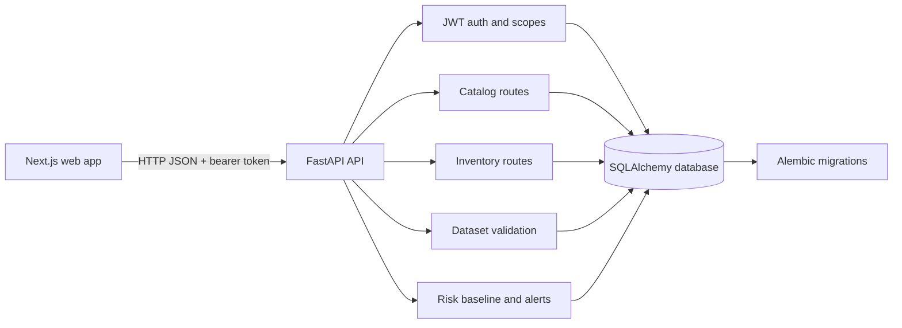
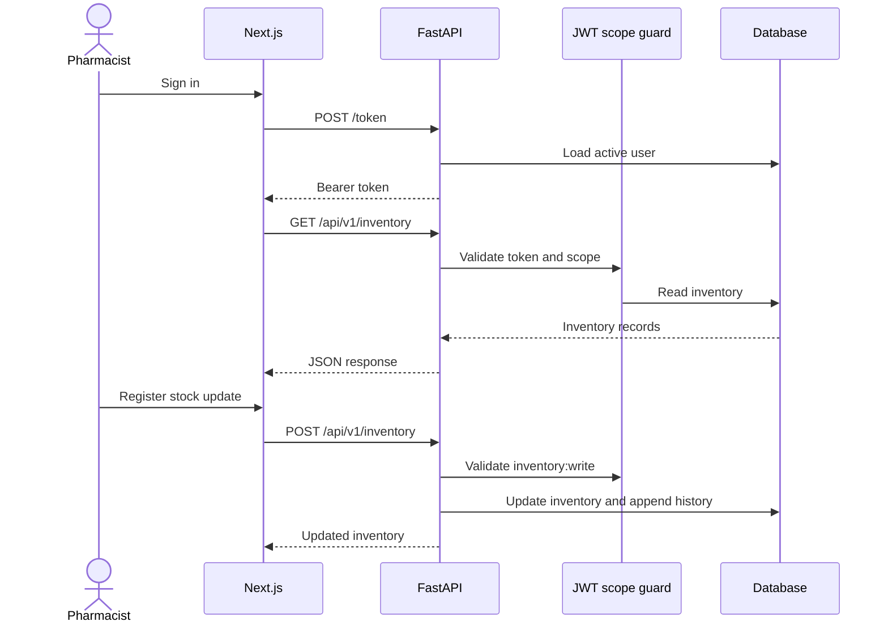
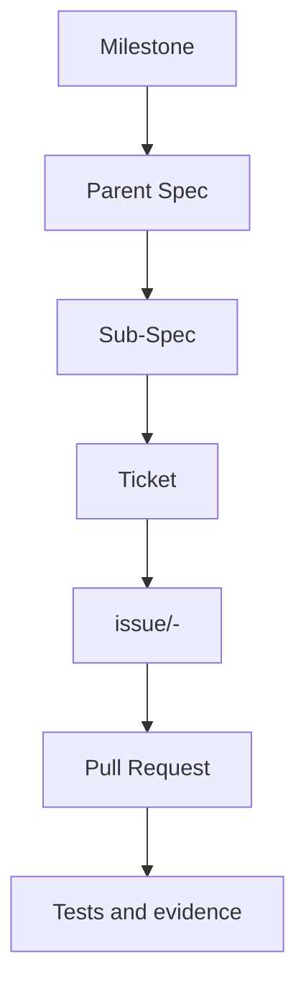

# DeepPharma

Academic and experimental software for medicine inventory management and
operational stockout-risk exploration. DeepPharma is **not** a clinical
decision system, does not claim institutional truth, and does not provide a
production SALMI integration.

> **Current status:** the approved MVP baseline and executable tracer bullet are
> published. Implementation can begin on the two tickets currently marked
> `status:ready`; the complete MVP remains under construction.

## What exists today

### Executable tracer bullet

- FastAPI API with SQLite local development and PostgreSQL-compatible
  configuration.
- JWT authentication with role-derived scopes.
- Medicine and health-center catalogs.
- Inventory read/update flow with inventory history.
- Dataset validation with row-level errors and immutable validation records.
- Deterministic operational-risk baseline (`baseline-rules-1`).
- Basic alert creation, acknowledgement and history.
- Next.js interface for login, inventory updates and alert acknowledgement.
- Alembic migration chain through the current local schema.

### Explicitly not complete

The following MVP capabilities are specified but still require implementation
and executable evidence:

- 30-day consumption-based coverage and `INDETERMINATE` handling.
- Versioned ML experiments, temporal validation and leakage controls.
- Auditable fallback activation and result lineage with `traceId`.
- Drift monitoring and operational explanations.
- Restricted audit queries with integrity verification.
- Simulated notifications with idempotent retry.
- Health-center scope enforcement, retention, incident controls and kill switch.
- Full release verification against AC-01–AC-14.

Synthetic, public, or explicitly authorised data only. No institutional data or
credentials belong in this repository.

## Architecture

The current implementation is a small modular monolith. The domain seams are
intentionally narrow so each MVP ticket can be implemented and verified
independently.



### Runtime request flow



### Delivery hierarchy



The public GitHub Project is the delivery index:

- [DeepPharma — MVP Project](https://github.com/users/quantumquirkxyz/projects/31)
- [Repository](https://github.com/quantumquirkxyz/DeepPharma)
- 5 milestones, 5 Parent Specs, 18 Sub-Specs and 18 Tickets.
- All work items are assigned to `quantumquirkxyz`.
- Current implementation frontier: Tickets [#25](https://github.com/quantumquirkxyz/DeepPharma/issues/25)
  and [#28](https://github.com/quantumquirkxyz/DeepPharma/issues/28).

## Local development

### Prerequisites

- Python 3.12+
- [`uv`](https://docs.astral.sh/uv/)
- Node.js compatible with the installed Bun release
- [`bun`](https://bun.sh/)

### Start the API

Use a fresh local SQLite file so an older local database cannot mask migration
problems:

```bash
cd apps/api
uv sync
export DATABASE_URL='sqlite:///./deeppharma-local.db'
export SECRET_KEY='replace-with-a-local-secret-of-at-least-32-bytes'
uv run alembic upgrade head
DEMO_PASSWORD='local-only-password' uv run python -m scripts.seed
uv run fastapi dev app/main.py
```

The API is available at `http://localhost:8000`. OpenAPI documentation is
available at `/docs`.

### Start the web app

In another terminal:

```bash
cd apps/web
bun install
NEXT_PUBLIC_API_URL='http://localhost:8000' bun run dev
```

The web app is available at `http://localhost:3000`.

## API surface

| Area | Endpoint | Purpose |
|---|---|---|
| System | `GET /health` | Service liveness |
| Auth | `POST /token` | Obtain a scoped bearer token |
| Catalog | `GET /api/v1/catalog/medicamentos` | List medicines |
| Catalog | `GET /api/v1/catalog/centros-salud` | List health centers |
| Inventory | `GET/POST /api/v1/inventory` | Read or update current stock |
| Inventory | `GET /api/v1/inventory/{id}/history` | Read inventory history |
| Datasets | `POST /api/v1/datasets/validate` | Validate and persist dataset intake |
| Risk | `POST /api/v1/risk/evaluate` | Evaluate the deterministic baseline |
| Risk | `GET /api/v1/predictions` | List risk results |
| Alerts | `GET /api/v1/alerts` | List active alerts |
| Alerts | `PATCH /api/v1/alerts/{id}` | Manage an alert |
| Alerts | `GET /api/v1/alerts/{id}/history` | Read alert history |

## Verification

Run the product checks from the repository root:

```bash
cd apps/api
uv run pytest --cov=app --cov-report=term-missing

cd ../web
bun run lint
bun run build
```

Latest local evidence:

- API: **12 tests passed**, 93% statement coverage over 386 statements.
- Web: lint passed and production build passed.
- Corrected local HTTP benchmark: passed the initial evaluation thresholds,
  with environment limitations recorded.
- `alembic upgrade head` passes on a fresh SQLite database; `alembic check`
  currently reports nullability drift in six timestamp columns and is tracked
  as migration hardening work.
- Skill-bundle quality gate: currently blocked by missing external fixture
  files; this is separate from the API and web product gates.

Evidence and limitations are tracked in
[`docs/quality/evidence-register.md`](docs/quality/evidence-register.md).
Passing local checks do not constitute production, clinical, security or
institutional assurance.

## Engineering documentation

- [`CONTEXT.md`](CONTEXT.md): product boundary, vocabulary and repository rules.
- [`docs/requirements/`](docs/requirements/): requirements and traceability.
- [`docs/architecture/`](docs/architecture/): architecture views and risks.
- [`docs/design/`](docs/design/): UML source diagrams and exports.
- [`docs/adr/`](docs/adr/): canonical architectural decisions.
- [`docs/spec/`](docs/spec/): SDD constitution, specification, plan and tasks.
- [`docs/quality/`](docs/quality/): test plan, catalog and evidence register.
- [`docs/operations/`](docs/operations/): deployment, backup and incident
  runbooks.
- [Project organization checkpoint](.reports/checkpoints/project-organization-20261126.json):
  native fields, views and Status synchronization.

## Security and data rules

- Configure `SECRET_KEY` outside the repository.
- Never commit `.env` files, passwords, tokens, private keys or institutional
  data.
- Keep synthetic fixtures clearly labelled.
- Treat `baseline-rules-1` as an operational fallback, not a clinical model.
- Do not connect to SALMI or send institutional notifications without an
  authorised contract and approved implementation ticket.

## Contribution workflow

1. Start from a `status:ready` Ticket in the GitHub Project.
2. Create `issue/<number>-<slug>`.
3. Keep the change within the Ticket seam and acceptance criteria.
4. Add or update automated tests and evidence.
5. Open at most one Pull Request for the Ticket.
6. Keep the Ticket, branch and Pull Request metadata synchronized.

The canonical tracker format is documented in
[`docs/reference/agents/work-item-format.md`](docs/reference/agents/work-item-format.md).
